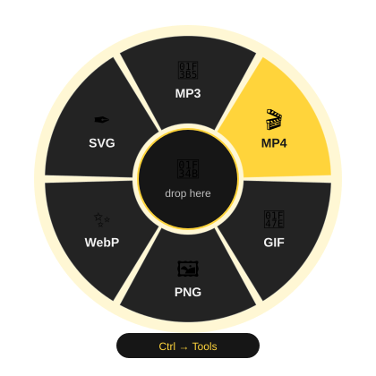

<p align="center">
  
</p>

<h1 align="center">Lemon 🍋</h1>

<p align="center">
  <b>Drag a file. Tap a key. Squeeze out a new format.</b><br>
  Convert video, audio and images without ever opening an app.
</p>

<p align="center">
  
  
  
  
  
</p>

<p align="center">
  
</p>

## What is it?

Lemon lives in your tray. Start dragging files in File Explorer, **tap Shift or Ctrl** while you hold them, and a radial wheel pops up right under your cursor. Drop on a slice and the result lands next to the original. That's it.

- **Radial wheel** over any window while you drag
- **Shift** = convert, **Ctrl** = tools (tap the other key to switch wheels)
- **Batch friendly**: drop many files, only actions that work for all of them show up
- **Safe**: originals are never moved or overwritten (`photo (1).png`)
- **Tray + toasts** with a "show in folder" shortcut, and optional start with Windows
- **Built-in tracer** that turns logos and drawings into real SVG

## What can it do?

| Wheel | You drag | You get |
| --- | --- | --- |
| Shift · Convert | Video, audio | MP3, WAV |
| Shift · Convert | Video | MP4 (H.264), GIF |
| Shift · Convert | Image, SVG | JPG, PNG, WebP, HEIC, TIFF, AVIF, BMP, GIF |
| Shift · Convert | Image | SVG (trace) |
| Ctrl · Tools | Video | Cut 10 s, Compress, Extract audio, Remove audio |
| Ctrl · Tools | Image | Reduce 50% |

Input formats: `mp4 mov mkv webm avi mp3 wav m4a flac jpg jpeg png webp heic heif tif tiff avif bmp gif svg`

> [!NOTE]
> Action titles in the wheel are currently in Spanish (see `ActionRegistry.cs`).

## Get started

**1. Install the tools Lemon calls under the hood**

```powershell
winget install Gyan.FFmpeg
winget install ImageMagick.ImageMagick
```

You also need the [.NET 8 SDK](https://dotnet.microsoft.com/download/dotnet/8.0). Lemon finds ImageMagick in `Program Files` or on your `PATH`, and FFmpeg on your `PATH`.

**2. Run it**

```powershell
dotnet run
```

Or build a release: `dotnet build -c Release`

## How to use it

1. Start Lemon. It hides in the tray, next to the clock.
2. Drag one or more files from File Explorer.
3. Without letting go, tap **Shift** (convert) or **Ctrl** (tools).
4. Drop on a slice. Dropping in the middle cancels.
5. A toast tells you when it's done, with a button to reveal the result.

> [!TIP]
> **SVG (trace)** shines on logos, signatures, icons and line art. On photos you'll get a silhouette.

> [!NOTE]
> The X button only hides the window. To quit, right-click the tray icon → **Salir** (Exit).

## Add your own action

One line in `ActionRegistry.All`: wheel, tool, file kinds, and a function that builds the arguments.

```csharp
Make("mute", "Quitar audio", "", Wheel.Tools, Tool.Ffmpeg, Video, null, "_sin_audio",
    (i, o) => new[] { "-i", i, "-an", "-c:v", "copy", o }),
```

## Project structure

```text
Actions/ActionRegistry.cs   Action catalog and which files each one accepts
Services/ToolRunner.cs      Runs FFmpeg / ImageMagick and the SVG tracing flow
Services/Vectorizer.cs      Contour tracer that outputs SVG
Services/Native.cs          Keyboard/mouse state via Win32
Services/Autostart.cs       Start with Windows
MainWindow.xaml.cs          Global key watcher and action execution
WheelOverlay.xaml.cs        Full-screen layer and wheel rendering
TrayIcon.cs, Toast.cs       Tray icon and notifications
```

## How the magic works

While you drag, File Explorer owns the keyboard, so Lemon polls the physical key and mouse state every 25 ms. When it sees Shift or Ctrl with the button held, it shows a nearly invisible full-screen layer that receives the OLE `DragEnter` and draws the wheel. The slice is picked by the cursor's angle from the center.

## Something off?

- Log file: `%TEMP%\lemon.log` (the "Ver detalles" button on error toasts opens it)
- Set `LEMON_DEBUG=1` to tint the invisible drag layer red and see where it lives
